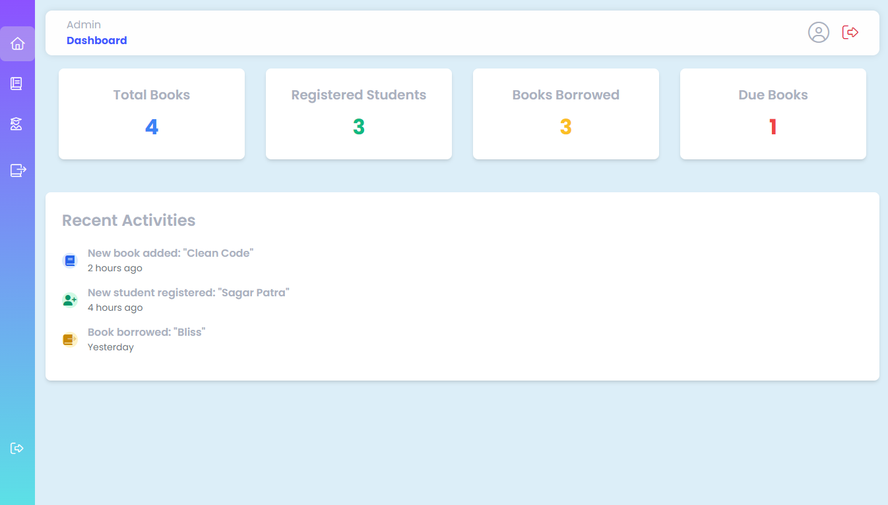

Here’s your updated content with the test admin credentials clearly included under a new section titled **🧪 Test Credentials** for visibility and organization:

---

# 📚📖 Library Management System

---

## 🌟✨ Overview

The **📚 Library Management System** is a 🌐 web-based application designed to streamline 📘 library operations. It helps manage 📖 books, 🙋 users, and administrative tasks efficiently, providing an intuitive interface for both 🔧 admins and 📚 library users.


---

## 🧪🔑 Test Credentials

Use the following test admin credentials to log in:

* **📧 Email**: `admin@gmail.com`
* **🔐 Password**: `1234`

---


## 🛠🔧 Features

* 🔒 **Secure Authentication**: Login and registration system for 🙋 users and 🔧 admins.
* 📖 **Book Management**: ➕ Add, ✏️ edit, ❌ delete, and 🔍 search for 📚 books in the catalog.
* 🧑‍💻 **Admin Dashboard**: Manage 📚 library operations and 🙋 users.
* 📊 **Responsive Design**: User-friendly interface that works on 📱 all devices.
* 💿 **SQL Database Integration**: Reliable data storage for all 📚 library records.


---

## ⚙️🛠 Technology Stack

* **🖼 Frontend**:

  * 🌐 HTML5, 🎨 CSS3
  * 🖱️ JavaScript

* **🔒 Backend**:

  * 🐘 PHP

* **💾 Database**:

  * 🐬 MySQL

---

## 🚀✨ Installation

### 🛠 Prerequisites

* **🐘 PHP**: Version 7.4 or later.
* **🐬 MySQL**: For 💾 database management.
* **🌐 Web Server**: 🖥 Apache or any compatible server (e.g., 🐘 XAMPP).

### 🔧 Steps

1. 🌀 Clone the repository:

   ```bash
   git clone https://github.com/ronisarkar-official/Library-Management-System.git
   ```

2. 🗂️ Navigate to the project folder:

   ```bash
   cd Library-Management-System
   ```

3. 📥 Import the 💾 database:

   * Open **🌐 phpMyAdmin**.
   * ➕ Create a new database (e.g., `library_db`).
   * 📥 Import the `library_db.sql` file located in the `/db` folder.

4. 🔗 Configure the 💾 database connection:

   * ✏️ Update the database credentials in `server/connect.php`.

5. 🖥 Start the server:

   * Run your local server (e.g., 🐘 XAMPP, 🐘 MAMP, 🐘 WAMP).
   * Access the project at `http://localhost/Library-Management-System`.

---

## 🌟📷 Screenshots

### 🏠 Home Page


### 🖥 Admin Dashboard



---

## 👨‍💻🤝 Contributing

Contributions are ❤️ welcome! To contribute:

1. 🍴 Fork the repository.
2. ➕ Create a 🌱 feature branch:

   ```bash
   git checkout -b feature-name
   ```
3. 📝 Commit your changes:

   ```bash
   git commit -m "Add your message here"
   ```
4. 📤 Push to the branch:

   ```bash
   git push origin feature-name
   ```
5. 📨 Open a Pull Request.

---

## 🖍️📜 License

This project is licensed under the **⚖️ MIT License**. Feel free to use and ✏️ modify it as needed.

---

## 🙌🙏 Acknowledgments

* **🐘 PHP.net** for 📄 documentation.
* **✨ Tailwind CSS** for providing an amazing 🎨 styling framework.

---

## 📧📞 Contact

**Roni Sarkar**
📍 🌏 West Bengal, India
📧 Email: [dashingroni2004@gmail.com](mailto:ronisarkar10938@gmail.com)
🌐 Website: [Portfolio](https://roni-sarkar.vercel.app/)


